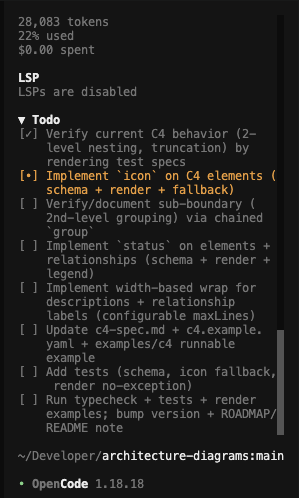
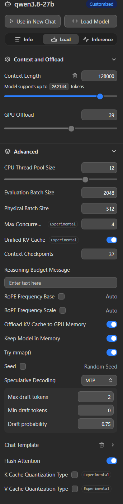

I use a coding agent every day. What bothered me wasn't the tool — it was where the code went. Every prompt carries repository snippets, project structure, sometimes infrastructure config. Sending that to a third-party API is a decision, not a detail. And there's the monthly bill, which during a heavy refactor week is far from symbolic.

I already had two GPUs attached to a K3s cluster at home. The question became: can the whole agent run in there?

It can. But the path has a trap that's worth the entire post.



---

## What runs where

The cluster has two nodes, each with a GPU and a different role:

| Node | GPU | Model served | Purpose |
|---|---|---|---|
| `hades` | RTX 4070 Super | `qwen3:14b`, `nomic-embed-text` | light chat, embeddings, fallback |
| `cerberus` | RTX 5090 | Qwen3 27B–35B | coding agent, reasoning |

The second node joins the cluster over a mesh network and carries a dedicated taint (`dedicated=llm:NoSchedule`) — only LLM workloads get scheduled there. That keeps a random pod from stealing VRAM in the middle of an inference run.

Models are served by Ollama, which exposes an OpenAI-compatible API under `/v1`. That's what lets any client speaking the OpenAI protocol plug in without an adapter.

---

## Wiring the agent to local models

I use [OpenCode](https://opencode.ai) as the client. The config registers each backend as a separate provider:

```json
{
  "model": "ollama-cerberus/qwen3.8:27b-agent",
  "provider": {
    "ollama-cerberus": {
      "npm": "@ai-sdk/openai-compatible",
      "name": "Ollama Cerberus",
      "options": {
        "baseURL": "http://ollama-cerberus.ai-tools:11434/v1",
        "timeout": 600000
      },
      "models": {
        "qwen3.8:27b-agent": {
          "name": "Qwen3.8 27B (quality)",
          "tool_call": true,
          "reasoning": true,
          "vision": true,
          "limit": { "context": 256000, "output": 40960 }
        }
      }
    }
  }
}
```

The part that matters here is the `limit` block. Every catalogued model declares its own context window and its own output ceiling. I currently have around 19 models registered, ranging from 32k to 256k of context. It looks like bureaucracy — and it's exactly what saved the setup later.

The 600-second timeout isn't excessive either. A 35B model chaining tool calls takes minutes, and the 30s default cuts the request in half.

---

## The problem: responses came back empty

With everything in place, the agent started doing something absurd: it would think, call a tool, think again — and return **nothing**. Empty string. No error, no stack trace, no failure log.

What the API returned was this:

```json
{
  "finish_reason": "length",
  "usage": { "completion_tokens": 0 }
}
```

`finish_reason: "length"` means the model hit the token ceiling. But `completion_tokens: 0` says it produced no output at all. Those two together make no sense — unless you know what the Qwen3 family does under the hood.

---

## The cause: reasoning eats the budget

Qwen3 models are hybrid thinking models. Before answering, they emit a `<think>...</think>` block containing their reasoning. That block **counts against the output budget** — and in some APIs it doesn't even show up in `completion_tokens`.

Here's what was happening: the harness forced a fixed `max_tokens` of 16,384. The model spent all 16,384 tokens thinking. By the time it was ready to write the actual answer, there was no budget left. The generation got cut off, the reasoning block was discarded, and what reached the client was an empty string with `finish_reason: "length"`.

The obvious fix is to turn thinking off. There's a flag for it: `think: false`. Except the runtime I was using at the time **ignored the flag** — a confirmed bug in the [LM Studio bug tracker (#1990)](https://github.com/lmstudio-ai/lmstudio-bug-tracker/issues/1990).

So turning reasoning off wasn't something I could rely on. I needed layered defense.

---

## The fix

I ended up with three independent layers, each covering the previous one's failure.

**1. Force `think: false` on every Qwen3 variant.** Solves it on runtimes that honor the flag.

**2. Stop forcing a fixed `max_tokens`.** This is the layer that actually fixes the symptom. Instead of an arbitrary ceiling, I use the per-model `limit.output` declared in the catalog — that block that looked like bureaucracy. With 40,960 output tokens instead of 16,384, the reasoning block finishes and there's still budget left for the answer.

**3. Strip `<think>` from the final text.** Even with the first two, a stray tag leaks through some path. A regex in the client cleans up whatever gets past:

```python
_THINK_TAG_RE = re.compile(r"<think>.*?</think>", re.DOTALL | re.IGNORECASE)

def _strip_thinking(text: str) -> str:
    """Remove <think>...</think> blocks left by reasoning models."""
    return _THINK_TAG_RE.sub("", text).strip()
```

Since OpenCode doesn't propagate some of these parameters from config into the request, I wrote a TypeScript plugin that intercepts the outbound payload:

```typescript
const plugin: Plugin = async () => ({
  "chat.params": async (input, output) => {
    // Hybrid Qwen3 emits tool calls inside <think> blocks,
    // which the client cannot execute.
    if (/qwen3(\.|-)?/i.test(input.model.id)) {
      output.options.think = false;
    }

    // Honor the model's declared limit instead of a fixed ceiling.
    const maxOutputTokens = input.model.limit.output || profile.maxOutputTokens;
    output.maxOutputTokens = maxOutputTokens;
    output.options.max_tokens = maxOutputTokens;
  },
});
```

---

## The second problem: repetition loops

With thinking disabled, another behavior showed up. Generations without reasoning — or with short reasoning — fall into degenerate loops far more easily. The agent would reissue the same tool call, with the same arguments, indefinitely. It called `read_file` on the same file five times in a row.

What fixed it was a modest frequency penalty:

```typescript
output.options.frequency_penalty = 0.3;
```

It discourages re-emitting recently used tokens without hurting normal code output. Higher values started interfering with indentation and repeated variable names — 0.3 is where it stopped repeating without starting to invent.

In the same plugin I defined sampling profiles per task type, because what works for writing code doesn't work for planning:

| Profile | Temperature | `top_p` |
|---|---|---|
| `build` (writing code) | 0.25 | 0.92 |
| `plan` (planning) | 0.30 | 0.92 |
| `general` | 0.40 | 0.95 |
| `compaction` (summarizing context) | 0.20 | 0.90 |

---

## What changed in the workflow, beyond the model

Two things mattered more to the outcome than the choice of model.

**A versioned `AGENTS.md` in every repository.** A short file with the project's real commands, the architecture in three lines, and — most importantly — the gotchas. Things like "relative imports must end in `.js` because of ESM + NodeNext" or "CI only smoke-tests examples in the top-level directory". That's the kind of information the model can't infer from the code, and without it, it makes the same mistake every time.

**Capping the window instead of filling it.** Having 256k of context doesn't mean using 256k is good. I keep automatic compaction on with a fixed token reserve, and the result beats dumping the whole repository into the prompt.



---

## What's still unsolved

I won't pretend this matches a frontier model.

- **Long tasks degrade.** A refactor spanning eight interdependent files still comes out better on a large API model. Local does well up to three or four related files.
- **Speed.** A long prompt on a 35B model has time-to-first-token in the tens of seconds. For fast iteration, that hurts.
- **I did try vLLM** as an Ollama alternative, built the PoC on the cluster, and ended up reverting. The throughput gain didn't justify the complexity of keeping quantization and tool parsers working for each new model. The manifests are still in the repo, commented out.
- **VRAM contention is real.** When the audio transcription service comes up on the same GPU, inference suffers. I worked around it with lazy loading and idle unloading in the transcription service, but that's a patch, not architecture.

---

## Is it worth it?

For what I do, yes. Personal project code and infrastructure config never leave the house, the marginal cost per prompt is zero — that `$0.00 spent` in the first image is real — and the hardware was already bought for something else.

The lesson I'm taking isn't about local models, it's about abstraction layers. Nearly every problem here came from some point in the chain assuming a default on my behalf: a fixed `max_tokens`, a silently ignored flag, a config parameter that never reached the request. None of them raised an error. All of them produced empty or strange output, which is much harder to diagnose.

When the whole stack is yours, you can open each layer and see what it's deciding without telling you.
