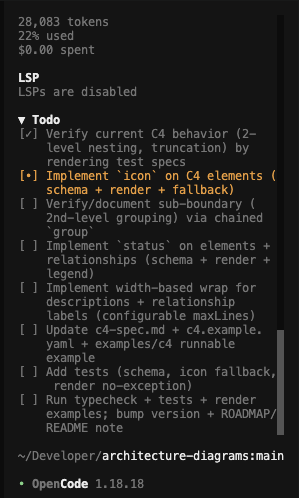
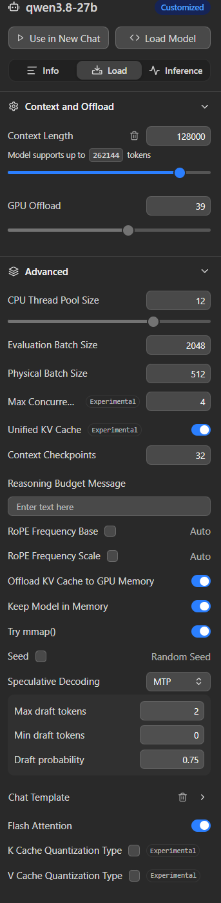

Uso agente de código todo dia. O que me incomodava não era a ferramenta — era onde o código passava. Todo prompt carrega trecho de repositório, estrutura de projeto, às vezes configuração de infraestrutura. Mandar isso para uma API de terceiro é uma decisão, não um detalhe. E tem a conta no fim do mês, que numa semana de refactor pesado não é simbólica.

Eu já tinha duas GPUs ligadas num cluster K3s em casa. A pergunta virou: dá pra rodar o agente inteiro ali dentro?

Dá. Mas o caminho tem uma armadilha que vale o post inteiro.



---

## O que roda onde

O cluster tem dois nós, cada um com uma GPU e um papel diferente:

| Nó | GPU | Modelo servido | Uso |
|---|---|---|---|
| `hades` | RTX 4070 Super | `qwen3:14b`, `nomic-embed-text` | chat leve, embeddings, fallback |
| `cerberus` | RTX 5090 | Qwen3 de 27B–35B | agente de código, raciocínio |

O segundo nó entra no cluster por uma rede mesh e carrega um taint dedicado (`dedicated=llm:NoSchedule`) — só workload de LLM é agendado nele. Isso evita que um pod qualquer roube VRAM no meio de uma inferência.

Os modelos são servidos por Ollama, com uma API OpenAI-compatible em `/v1`. É isso que permite plugar qualquer cliente que fale o protocolo da OpenAI sem adaptador.

---

## Ligando o agente nos modelos locais

Uso o [OpenCode](https://opencode.ai) como cliente. A configuração registra cada backend como um provider separado:

```json
{
  "model": "ollama-cerberus/qwen3.8:27b-agent",
  "provider": {
    "ollama-cerberus": {
      "npm": "@ai-sdk/openai-compatible",
      "name": "Ollama Cerberus",
      "options": {
        "baseURL": "http://ollama-cerberus.ai-tools:11434/v1",
        "timeout": 600000
      },
      "models": {
        "qwen3.8:27b-agent": {
          "name": "Qwen3.8 27B (qualidade)",
          "tool_call": true,
          "reasoning": true,
          "vision": true,
          "limit": { "context": 256000, "output": 40960 }
        }
      }
    }
  }
}
```

O detalhe que importa aqui é o bloco `limit`. Cada modelo do catálogo declara a própria janela de contexto e o próprio teto de saída. Hoje tenho cerca de 19 modelos registrados, variando de 32k a 256k de contexto. Parece burocracia — e foi exatamente o que salvou o setup depois.

O `timeout` de 600 segundos também não é exagero. Um modelo de 35B fazendo tool calling em sequência leva minutos, e o padrão de 30s corta a request no meio.

---

## O problema: a resposta voltava vazia

Com tudo no lugar, o agente começou a fazer algo absurdo: pensava, chamava ferramenta, pensava de novo — e devolvia **nada**. String vazia. Sem erro, sem stack trace, sem log de falha.

O que a API retornava era isto:

```json
{
  "finish_reason": "length",
  "usage": { "completion_tokens": 0 }
}
```

`finish_reason: "length"` significa que o modelo bateu no teto de tokens. Mas `completion_tokens: 0` diz que ele não produziu saída nenhuma. As duas coisas juntas não fazem sentido — a menos que você saiba o que a família Qwen3 faz por baixo.

---

## A causa: o raciocínio come o orçamento

Modelos Qwen3 são híbridos de *thinking*. Antes da resposta, emitem um bloco `<think>...</think>` com o raciocínio. Esse bloco **conta no orçamento de saída** — e, em algumas APIs, nem aparece no `completion_tokens`.

O que acontecia era isto: o harness forçava um `max_tokens` fixo de 16.384. O modelo gastava os 16.384 tokens inteiros pensando. Quando ia começar a escrever a resposta de verdade, não sobrava orçamento. A geração era cortada, o bloco de raciocínio descartado, e o que chegava ao cliente era uma string vazia com `finish_reason: "length"`.

A correção óbvia é desligar o thinking. Existe flag pra isso: `think: false`. Só que o runtime que eu usava naquele momento **ignorava a flag** — bug confirmado no [bug tracker do LM Studio (#1990)](https://github.com/lmstudio-ai/lmstudio-bug-tracker/issues/1990).

Ou seja: não dava pra confiar em desligar o raciocínio. Precisava de defesa em camadas.

---

## A correção

Acabei com três camadas independentes, cada uma cobrindo a falha da anterior.

**1. Forçar `think: false` em toda variante Qwen3.** Resolve nos runtimes que respeitam a flag.

**2. Parar de forçar `max_tokens` fixo.** Esta é a camada que realmente conserta o sintoma. Em vez de um teto arbitrário, uso o `limit.output` declarado por modelo no catálogo — aquele bloco que parecia burocracia. Com 40.960 tokens de saída em vez de 16.384, o bloco de raciocínio termina e ainda sobra orçamento para a resposta.

**3. Remover `<think>` do texto final.** Mesmo com as duas anteriores, tag residual vaza por algum caminho. Um regex no cliente limpa o que passar:

```python
_THINK_TAG_RE = re.compile(r"<think>.*?</think>", re.DOTALL | re.IGNORECASE)

def _strip_thinking(text: str) -> str:
    """Remove blocos <think>...</think> deixados por modelos de raciocínio."""
    return _THINK_TAG_RE.sub("", text).strip()
```

Como o OpenCode não propaga alguns desses parâmetros da configuração para a request, escrevi um plugin em TypeScript que intercepta o payload de saída:

```typescript
const plugin: Plugin = async () => ({
  "chat.params": async (input, output) => {
    // Qwen3 híbrido emite tool calls dentro de blocos <think>,
    // que o cliente não consegue executar.
    if (/qwen3(\.|-)?/i.test(input.model.id)) {
      output.options.think = false;
    }

    // Respeita o limite declarado do modelo em vez de um teto fixo.
    const maxOutputTokens = input.model.limit.output || profile.maxOutputTokens;
    output.maxOutputTokens = maxOutputTokens;
    output.options.max_tokens = maxOutputTokens;
  },
});
```

---

## O segundo problema: loops de repetição

Com o thinking desligado, apareceu outro comportamento. Gerações sem raciocínio — ou com raciocínio curto — entram em loop degenerado com muito mais facilidade. O agente reemitia a mesma tool call, com os mesmos argumentos, indefinidamente. Chamava `read_file` no mesmo arquivo cinco vezes seguidas.

O que resolveu foi uma penalidade modesta de frequência:

```typescript
output.options.frequency_penalty = 0.3;
```

Desencoraja reemitir tokens usados recentemente sem estragar a saída de código normal. Valores mais altos começaram a atrapalhar identação e nomes repetidos de variável — 0.3 foi onde parou de repetir sem começar a inventar.

No mesmo plugin defini perfis de sampling por tipo de tarefa, porque o que serve para escrever código não serve para planejar:

| Perfil | Temperatura | `top_p` |
|---|---|---|
| `build` (escrever código) | 0.25 | 0.92 |
| `plan` (planejar) | 0.30 | 0.92 |
| `general` | 0.40 | 0.95 |
| `compaction` (resumir contexto) | 0.20 | 0.90 |

---

## O que mudou no fluxo, além do modelo

Duas coisas tiveram mais impacto no resultado do que a escolha de modelo.

**`AGENTS.md` versionado em cada repositório.** Um arquivo curto com os comandos reais do projeto, a arquitetura em três linhas e — mais importante — os *gotchas*. Coisas como "imports relativos precisam terminar em `.js` por causa de ESM + NodeNext" ou "o CI só faz smoke test dos exemplos do diretório raiz". É o tipo de informação que o modelo não infere do código e que, sem ela, ele erra sempre do mesmo jeito.

**Limitar a janela em vez de encher.** Ter 256k de contexto não significa que usar 256k seja bom. Deixo a compactação automática ligada com uma reserva fixa de tokens, e o resultado é melhor do que despejar o repositório inteiro no prompt.



---

## O que ainda não está resolvido

Não vou fingir que é equivalente a um modelo de fronteira.

- **Tarefas longas degradam.** Refactor que atravessa oito arquivos com dependência entre eles ainda sai melhor em modelo grande de API. Local vai bem até uns três ou quatro arquivos relacionados.
- **Velocidade.** Prompt longo em modelo de 35B tem latência de primeira resposta na casa de dezenas de segundos. Para iteração rápida, incomoda.
- **Cheguei a testar vLLM** como alternativa ao Ollama, montei o PoC no cluster, e acabei voltando. O ganho de throughput não compensou a complexidade de manter quantização e tool parser funcionando para cada modelo novo. Os manifests continuam no repositório, comentados.
- **Contenção de VRAM é real.** Quando o serviço de transcrição de áudio sobe na mesma GPU, a inferência sofre. Resolvi com lazy loading e descarregamento por inatividade no serviço de transcrição, mas é remendo, não arquitetura.

---

## Vale a pena?

Para o que eu faço, vale. Código de projeto pessoal e configuração de infraestrutura não saem de casa, o custo marginal por prompt é zero — aquele `$0.00 spent` da primeira imagem é real — e o hardware já estava comprado para outra coisa.

O aprendizado que levo não é sobre modelo local, é sobre camada de abstração. Quase todo problema aqui veio de algum ponto do caminho assumir um padrão em nome do usuário: um `max_tokens` fixo, uma flag ignorada silenciosamente, um parâmetro de configuração que não chega na request. Nenhum deles deu erro. Todos deram resultado vazio ou estranho, que é bem pior de diagnosticar.

Quando o stack inteiro é seu, você pode abrir cada camada e ver o que ela está decidindo sem te avisar.
